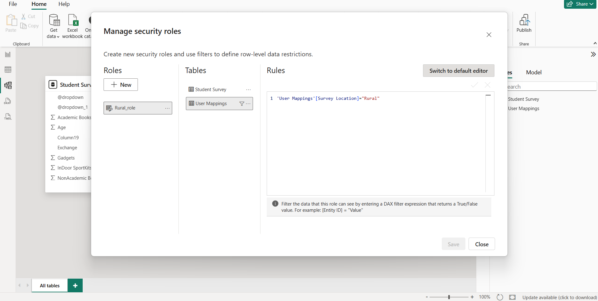
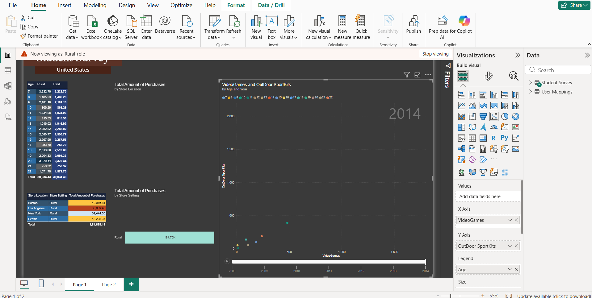
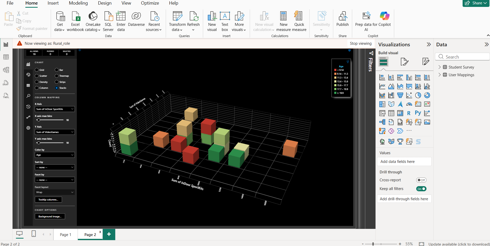
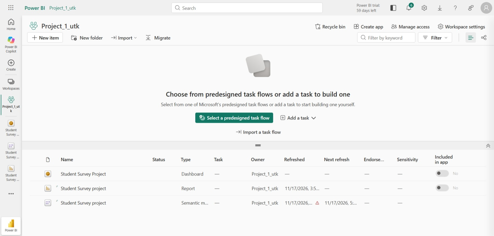
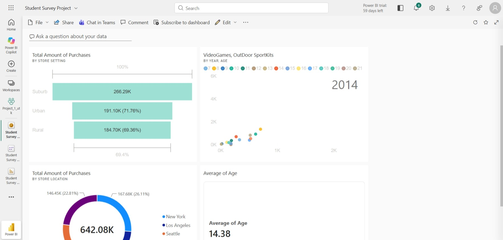
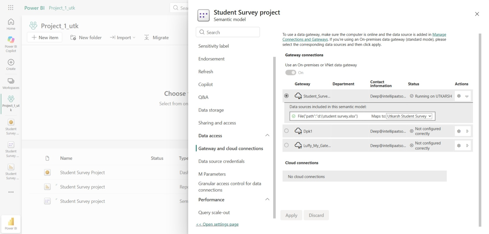
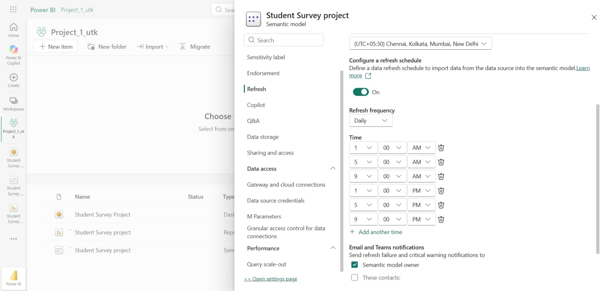
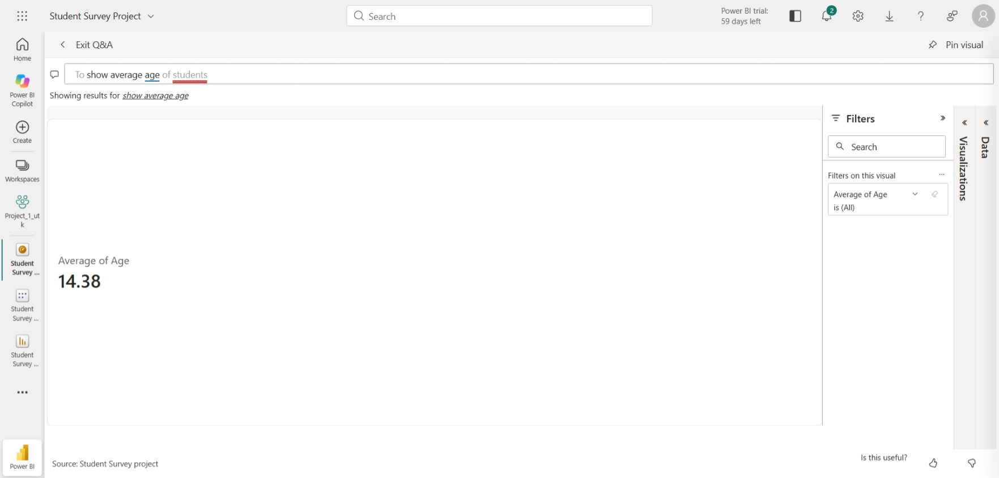
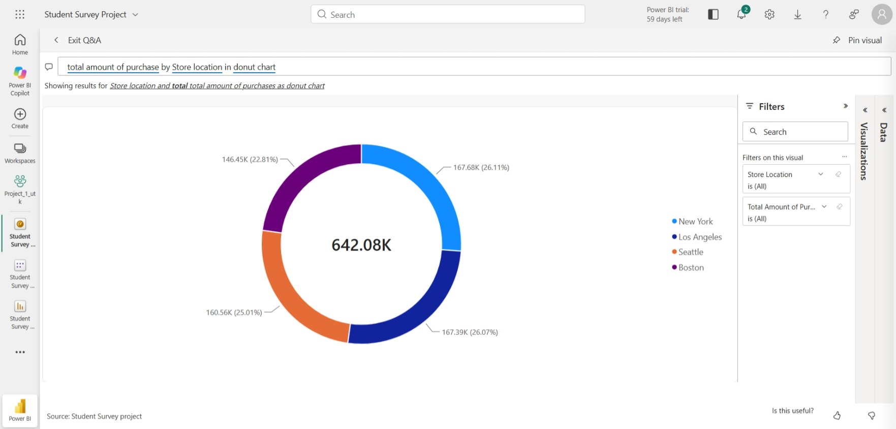

**📊 Student Survey Analysis – Power BI Project**

> End-to-end Power BI project: data modelling, interactive report, row-level security, cloud publishing, dashboard, scheduled refresh and Q&A.


**Industry:** Retail Store | **Tool:** Microsoft Power BI (Desktop + Service) |

## 📌 Project Overview
In the United States, there are many stores in which a survey was
conducted based on students i.e. how much they are spending on different kinds
of purchases like Video games, Indoor games, Toys, Books, Gadgets etc. The goal was to extract meaningful insights and share them through a secure, auto-refreshing Power BI report and dashboard.


Student-Survey-PowerBI-Project/
├── data/         → Student_Survey.xlsx (source data)
├── report/       → Student_Survey_project.pbix (Power BI file)
├── screenshots/  → Report, RLS, dashboard, refresh and Q&A screenshots
├── docs/         → Project-1-Problem-Statement.pdf
├── README.md
└── .gitignore

Q1. Tabular Visualization – Conditional Formatting
- **Task:** Show Total Amount of Purchases (TAP) by Store Location and Store Setting with colour rules.
- **Rules applied:** 0 < TAP < 35,000 → 🔴 Red | 35,000 ≤ TAP < 60,000 → 🟡 Yellow | TAP ≥ 60,000 → 🔵 Blue.
- **Result:** Table covers 4 locations × 3 settings; grand total **6,42,084.01**.
- **How:** Table visual → Cell elements → Background colour → Rules.

### Q2. Matrix Visualization – Outdoor Sports
- **Task:** Amount spent on Outdoor Sports across Age and Store Setting.
- **Build:** Rows = Age, Columns = Store Setting (Rural, Suburb, Urban), Values = Outdoor SportKits.
- **Formatting:** Colour scale on values; grand total **1,13,761.72**.

- ### Q3. Funnel Chart – Purchases by Store Setting
- **Task:** Total Amount of Purchases by Store Setting, labels as *Percentage of First*.
- **Insight:** Suburb is the largest (**266.29K = 100%**), Urban **191.10K (71.76%)**, Rural **184.70K (69.36%)**.

- ### Q4. Pie Chart – Suburban Stores Only
- **Task:** Purchases by Store Location for Suburb setting only (filter context).
- **Method:** Visual-level filter `Store Setting = Suburb`.
- **Insight:** Seattle **83.75K (31.45%)**, Los Angeles **82.42K (30.95%)**, Boston **53.84K (20.22%)**, New York **46.28K (17.38%)** – total 266.29K.

- ### Q5. Scatter Plot & Sand Dance
- **5a – Scatter plot:** X = Video Games, Y = Outdoor SportKits, Details = Age, Play Axis = Year (2008–2014, animated).
- **5b – Sand Dance (custom visual):** X = Sum of Indoor SportKits, Y = Sum of Video Games, Colour by Age, chart type *Stacks*.

- ### Q6. Row-Level Security (RLS)
- **Task:** Restrict data access using the User Mappings table (e.g. Mani deals with Rural only, so she must not see Urban or Suburban data).
- **Role created:** `Rural_role` (*Modeling → Manage roles*), with a DAX filter on the `User Mappings` table:
```DAX
'User Mappings'[Survey Location] = "Rural"
```

- **Relationship:** `User Mappings` is related to `Student Survey`, so the filter flows into all report visuals.
- 
- 
- **Tested with *View as → Rural_role*:** the banner shows *"Now viewing as: Rural_role"*.
  - Table: only Rural rows (Boston, Los Angeles, New York, Seattle), total **1,84,699.18**.
  - Matrix: Rural column only, total **30,034.43**.
  - Funnel: only **Rural = 184.70K**.
  - Scatter and Sand Dance visuals update to Rural data only.
- **Next step in Power BI Service:** *Semantic model → Security →* add each user (e.g. Mani) to `Rural_role`. Create similar `Urban_role` and `Suburb_role` roles for the other users in the mapping table.

- ### Q7. Publish, Master Dashboard & Scheduled Refresh
- Report published to workspace **Project_1_utk**; the workspace contains the dashboard, report and semantic model.
- 
- **Master Dashboard** pins: Funnel chart, Scatter plot, plus Donut and Average Age tiles from Q&A.
- 
- **Data source:** Excel file via an on-premises data gateway (`Student_Survey` gateway).
- 
- **Scheduled refresh:** Daily, **6 times, every 4 hours** → 1 AM, 5 AM, 9 AM, 1 PM, 5 PM, 9 PM (UTC+05:30 India).
- 

- ### Q8. Power BI Q&A
- **8a:** *"show average age"* → **Average Age = 14.38**.
- 
- **8b:** *"total amount of purchase by Store location in donut chart"* → Total **642.08K**: New York 167.68K (26.11%), Los Angeles 167.39K (26.07%), Seattle 160.56K (25.01%), Boston 146.45K (22.81%).
- 

## 🔍 Key Insights
- Suburban stores generate the highest purchase value; Urban and Rural trail at ~72% and ~69% of Suburb.
- Spending is spread fairly evenly across the four cities (22–26% each); New York leads narrowly, Boston is lowest.
- Average student age in the survey is ~14.4 years.


